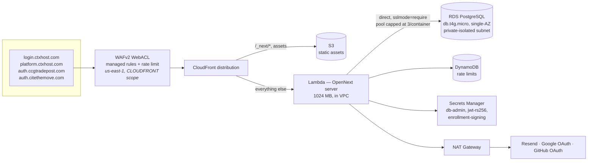
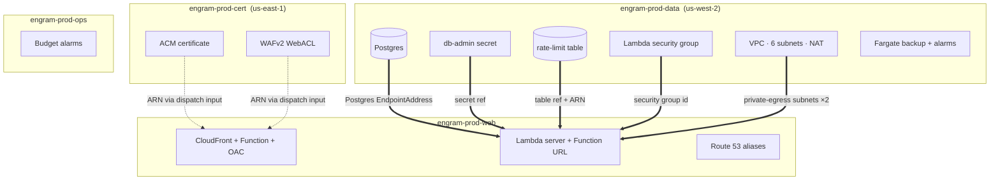

# aws-prod topology

Engram's production identity surface (ADR-025). Two views: the **request path**,
and the **stack boundaries** — the second is the one worth reading before you
change infrastructure, because it explains a failure mode that cost three
deploys on 2026-08-14.

Verified against live CloudFormation on 2026-08-15.

## Request path



Two things this view is meant to make obvious:

- **There is no connection pooler.** The Lambda talks to Postgres directly. The
  RDS Proxy was removed on 2026-08-14 (ADR-025 §3): it cost ~$22/month to pool a
  workload peaking at 9 concurrent executions and 9 backend connections. The
  ceiling is now enforced in `src/lib/prisma-config.ts`, which caps the
  per-container `pg` pool at 3 when `AWS_LAMBDA_FUNCTION_NAME` is set. That cap is
  load-bearing — node-postgres defaults to 10, and ~11 warm containers would
  exhaust `db.t4g.micro`'s ~112 connections.
- **The NAT Gateway exists for outbound egress only** — Resend for email, Google
  and GitHub for OAuth token exchange. It is ~$31/month and the single largest
  line in this diagram. It cannot simply be deleted; those three providers have to
  be reachable.

A separate Fargate task in the same VPC takes logical `pg_dump` backups to a
retained S3 bucket, with CloudWatch alarms on failure and on no-success-in-24h.
It connects to Postgres directly through its own security group.

## Stack boundaries and cross-stack exports



`==>` is a **CloudFormation export/import**. There are seven live, all published
by `engram-prod-data` and consumed by `engram-prod-web`. `-.->` is *not* an
export: the cert stack lives in another region, so its ARNs are passed as
workflow dispatch inputs resolved from live stack outputs at promotion time.

### The failure mode this view explains

**CDK generates an export because one stack *references* another's value — not
because a resource exists.** Remove the reference and the export disappears with
it, even if the resource is untouched.

On 2026-08-14, repointing `DATABASE_URL` from the proxy to the instance deleted
the only reference to `proxy.endpoint`. CDK stopped emitting that export, and
CloudFormation refused:

```
Cannot delete export engram-prod-data:ExportsOutputFnGetAttRdsProxy…Endpoint
as it is in use by engram-prod-web.
```

Three deploys failed on it. No sequencing fixes it — every variant where the web
stack stops referencing the proxy drops the export, so splitting the change across
commits, promoting the earlier commit, and reverting all fail identically.

**While it held, aws-prod could not deploy anything at all.** `engram-prod-web`
alone also failed, because the replacement import it needed
(`Postgres EndpointAddress`) is published by the same blocked data-stack update.
Treat an export-in-use failure as an availability incident, not a failed change.

The resolution is `Stack.exportValue()` to pin the export alive through an
intermediate deploy — full recipe in
[`docs/runbooks/prod-promotion.md`](../runbooks/prod-promotion.md#removing-a-cross-stack-export--exportvalue-not---ref).

**Before removing anything a `==>` edge touches, read that section.** The same
guard that blocks the delete is what kept both eventual deploys at zero downtime:
90/90 and 191/191 health samples returned 200.

## Deploy order

CDK deploys `data` → `web` (web imports from data), with `cert` always dispatched
alone because it produces inputs the others consume. `ops` is independent.

aws-prod **never** auto-deploys. Promotion is human-directed via
`scripts/promote-prod.sh`; an agent may dispatch it only when explicitly told to
for that specific promotion, after reporting a `--dry-run` (ADR-025 §11, amended
2026-08-14).
